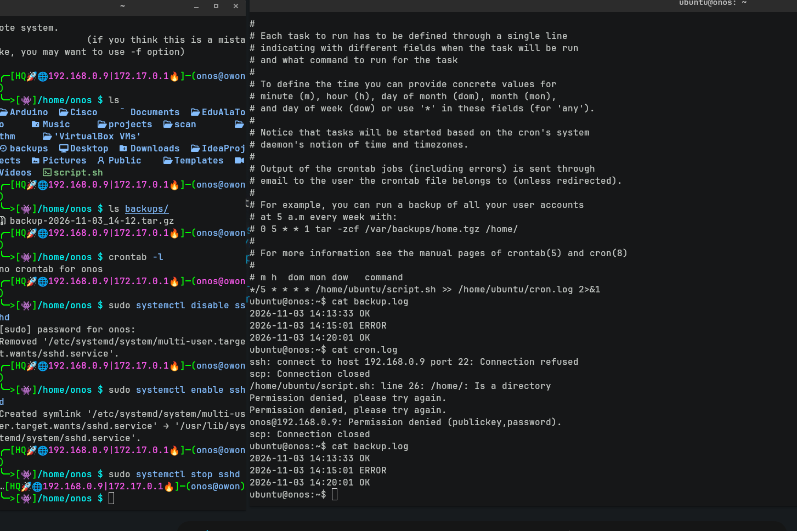
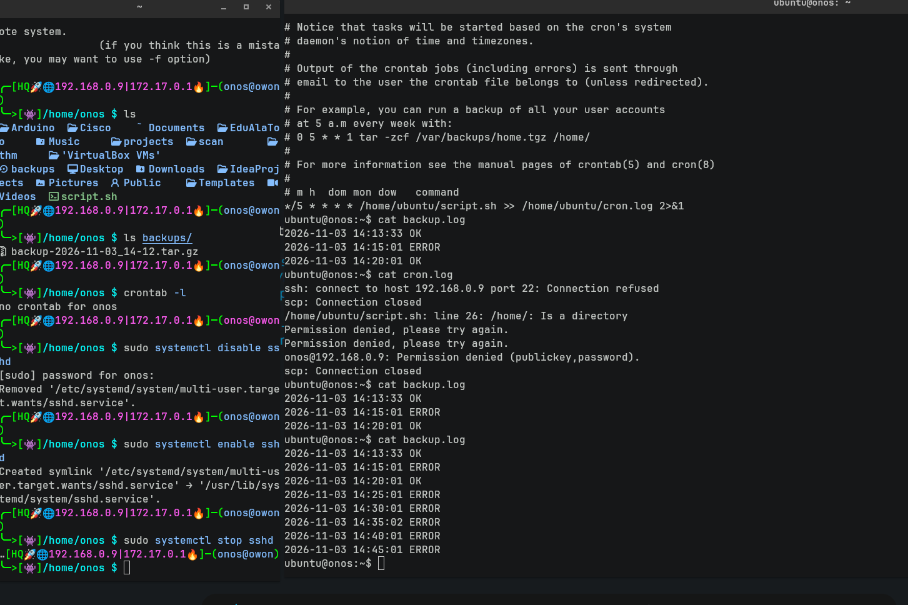
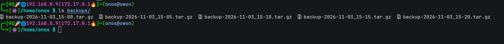
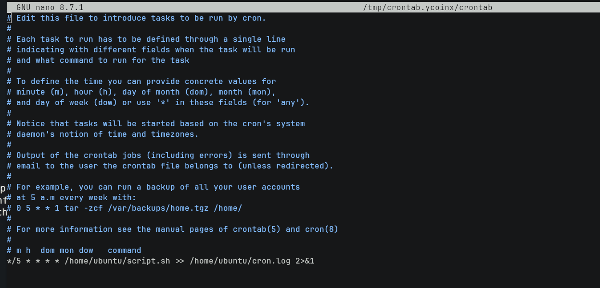

# Автоматизированный процесс через SSH

Клиент через SSH прокладывает бэкапы логгирования примитивного `journalctl`, (А и Б) машины, где в роли А выступает "отправитель", а Б это у нас сервер где он получает логи через SSH клиент.

---

## 0. SSH

SSH команда, которая подключается удаленно к машине, допустим:

```bash
ssh ubuntu@192.168.0.1
```

В курьезных ситуациях понадобится ключ команды как `-p` = `-PORT`. Добавляем порт перед ключевым значением того, к кому мы хотим подключиться:

```bash
ssh -p 2222 ubuntu@192.168.0.1
```

## Какие команды используются и в чем заключается синтаксис?

### 1. SHEBANG

`#!/bin/bash` показывает путь к интерпретатору, который будет запускать скрипт.

### 2. Переменные

Констант значений `TARGET_IP`, `PATH_TO_FILES`:

```bash
TARGET_IP="127.0.0.1"
```

### 3. mkdir, cp, echo, rm

| Команда | Что делает |
|---|---|
| `mkdir` | создание директорий |
| `cp` | копирование файлов |
| `echo` | вывод (print) |
| `rm` | удаление файлов (`-r` = recursively для директорий) |

### 4. journald

`journald` собирает логи `systemd` это система инициализации(что запускается первым при включения линукса). Через `systemctl` мы можем управлять службами. `journalctl` читать логи.

Ключ `--no-pager` дает текст без стрелок (вверх вниз) то есть выводит все сразу, без свайпа `less`.

### 5. tar

`tar` это распаковка (паковка) в архив, так же может создавать зип формат (`.tar.gz` | `.tgz`) .

Самое главное запомнить ключи команды:

| Ключ | Значение |
|---|---|
| `-c` | create (**НЕ СЖИМАЕТ ДАННЫЕ КАК ЗИП ФОРМАТ, СОЗДАЕТ ПРОСТО АРХИВ**) |
| `-x` | extract, извлечь (вытащить файлы с зип архива) |
| `-v` | verbose (показывать процесс работы команды `tar`) |
| `-f` | указать файл (куда именно) |
| `-C` | (directory) перейти в указанную директорию |
| `-t` | list, показывает содержимое |
| `-z` | использовать формат gzip(по сути zip) (`tar.gz`, **СЖИМАЕТ ДАННЫЕ**) |

### 6. scp

`scp` переводится как SECURE COPY PROTOCOL. Буквально одно и то же что и `cp` (синтаксис такой же практически), но выполняется уже на прикладном уровне сетей то есть на `SSH`.

Допустим:

```bash
scp file.txt ubuntu@TARGET_IP:TARGET_DESTINATION
```

Под `TARGET_IP` подразумевается айпи сервера, а под `TARGET_DESTINATION` куда мы хотим скинуть файл, как здесь:

```bash
scp file.txt ubuntu@192.168.0.1:/home/papka
```

Двоеточие между айпи и директорией обязательна, так как служит РАЗДЕЛИТЕЛЕМ между ними. Главную роль не играет, таков синтаксис.

### 7. tail

`tail` выводит последние строки логов для удобства. Вроде бы на словах есть `echo`, но при логгировании, где находятся тысячи строк,это очень сильно понадобится: ключи команды:

- `-n` = какое количество ты хочешь вывести, допустим `tail -n 50` выведет тебе последние 50 строк
- `-f` = follow, по сути логгирования в реальном времени:
- `-n +6` = выведет тебе все с 6 строки

```bash
tail -f /BAKAIBANK/errors.log
```

Предназначено для того чтобы смотреть что происходит за процессом, посмотреть на какую либо ошибку и так далее. Зависит что ты хочешь посмотреть, это команда `grep` (фильтрует строки),

### 8. xargs

`xargs` утилита, где она строится как конвеер между командой и выполняет его.

По странным причинам мы не можем написать:

```bash
cat folders.txt | mkdir
```

У `mkdir` нету значений что ему создавать, и в дело вступает `xargs`.

В файле `folders.txt` представьте что у вас там `[ photos images games ]`. Вам нужно создать три папки, но у `mkdir` нет аргументов чтобы где то брать, потому что мы же только читаем `folders.txt`, а не вытаскивает. И мы пишем:

```bash
cat folders.txt | xargs mkdir
```

В итоге у тебя в `ls` `/photos` `/images` `/games` и все готово.

Есть один замечательный ключ, это `-r` = no run if empty. Дословно дается понятие что он не будет запускаться если на входящем у него пусто.

### 9. if

```bash
if [ ... ]; then
    ...
fi
```

В `$?` это код возврата предыдущей команды, которая была выше условия в скрипте, он выполнял (`scp`). Если `scp` отдал `0` (что значит TRUE, прошел, он скинул файл), то он бежит по условию. А в `scp` в ошибках или таймаутах он дает `1`, что является `!= 0`, и он дальше не сможет пройти.
`-n +6` = начиная с 6-й строки . Именно так он используется в нашем скрипте:
`ls -t` = выводит по времени, новые выводятся первыми, то есть если 1 файл это самый старый а 9 файл самый новый, выведется 9,8,7,6,5,4,3,2,1 по дате времени, (с помощью tail -n +6 выводит строки начиная с 6-й до самого конца) выведется значит `4,3,2,1` и через xargs -r rm, будут удалены 4,3,2,1, а останутся 9,8,7,6,5 (5 самых новых)

Само условие из нашего скрипта:

```bash
scp "/tmp/${ARCHIVE_NAME}" "${REMOTE_USER}@${REMOTE_IP}:backups/"

if [ $? -eq 0 ]; then
    echo "$(date '+%F %T') OK" >> "$LOG_FILE"
    ssh "$REMOTE_USER@$REMOTE_IP" "cd backups && ls -t | tail -n +6 | xargs -r rm"
else
    echo "$(date '+%F %T') ERROR" >> "$LOG_FILE"
fi
```

Разбор синтаксиса:

| Часть | Что значит |
|---|---|
| `scp ...` | команда, результат которой мы проверяем (стоит строго перед `if`) |
| `if [ $? -eq 0 ]` | если код возврата равен 0 (`-eq` = equal, сравнение чисел) |
| `; then` | то выполнить следующие команды |
| `echo ... OK` | записать в лог успех |
| `ssh ... xargs -r rm` | удалить старые архивы на B |
| `else` | иначе, если код не 0 |
| `echo ... ERROR` | записать в лог ошибку |
| `fi` | конец условия (`if` задом наперёд) |

Пробелы внутри `[ ]` обязательны: `[ $? -eq 0 ]`, а не `[$? -eq 0]`.

---






